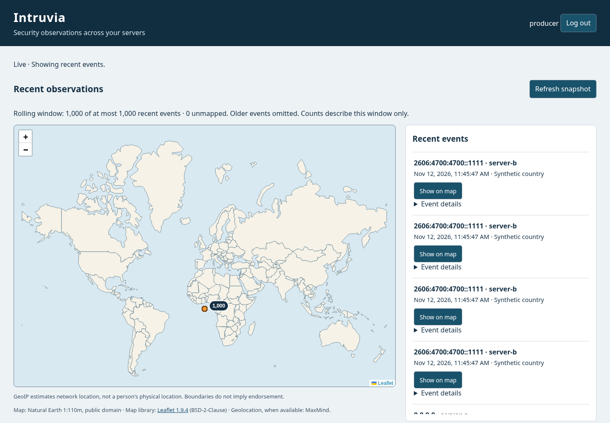

<h1 align="center">Intruvia</h1>

<strong>A clear, live view of Fail2ban activity across your servers.</strong>

  Intruvia brings ban notifications together in an authenticated map and recent-events timeline. 
  Self-host it and keep your event history and optional GeoIP data under your control.

  
  
  

  <a href="docs/DEPLOYMENT.md"><strong>Get started with deployment →</strong></a>
  &nbsp;·&nbsp;
  <a href="integrations/fail2ban/README.md">Connect Fail2ban</a>

  

Viewer preview from a capacity test. The displayed events and locations are synthetic test data.

## A shared view of security events

| Live at a glance | Multiple servers | Local by design |
| --- | --- | --- |
| See new ban notifications on a world map and in a recent-events list. | Bring reporting servers together in one authenticated viewer. | Store history in PostgreSQL and optionally enrich IPs with a locally supplied MaxMind City database. |

Map assets are bundled, so the viewer does not require an external tile service, browser API key, or frontend CDN.

## How it works

1. An additive Fail2ban action sends a notification when a new ban occurs.
2. Intruvia authenticates the reporting server, records the event, and attempts local IP geolocation.
3. Signed-in viewers see the event and any available location details.

## Scope and limits

- **Read-only by design.** Intruvia displays events; it does not issue ban or unban commands, manage firewall rules, or report current firewall state.
- **Best-effort notifications.** The Fail2ban integration makes bounded retries but has no persistent offline queue. Events can be lost during outages; notification failure does not stop the normal ban action.
- **Approximate locations.** GeoIP estimates a network location, not a person or precise address. Some IPs have no location, and the viewer works when GeoIP data is unavailable.
- **Bounded history.** Events are retained for up to 30 days and 100,000 records, whichever limit is reached first; older history is removed as limits are reached.

## Get started

The [installation and recovery guide](docs/DEPLOYMENT.md) covers the Compose and
standalone deployment paths, prerequisites, credentials, upgrades, backups, and
recovery. To connect a server, follow the [Fail2ban integration guide](integrations/fail2ban/README.md)
and add its notification action alongside the existing firewall action.

Compose bundles include protected local directories for database, runtime, logs and
proxy state instead of Docker named volumes. Existing named-volume installations need
the explicit offline migration in the [recovery guide](docs/deployment/compose-initialization-recovery.md#migrate-an-existing-named-volume-installation).

Docker releases use major, major.minor, and full patch-version tags; versions
without a `-SNAPSHOT` suffix also publish as `latest`. Snapshot builds retain
`-SNAPSHOT` on each version tag and never publish `latest`. The `latest` tag is
mutable and follows the most recently published non-SNAPSHOT version, so release
older versions only when you intend to move `latest` backward.

On compatible Compose images, first start creates an administrator password in memory
and prints it once to the attached console. Sign in with `admin`; **Manage access** lets
you configure viewer accounts, machines, stable instance IDs, and scoped ingestion
tokens without editing runtime files. Newly issued token values are shown once. If the
password output is missed, the guide documents a stopped-app reset. The published
`0.0.2` image predates this file-free startup flow; no compatible published version is
claimed here.

## Project links

[Release notes](docs/RELEASE_NOTES.md) · [Developer reference](docs/DEVELOPMENT.md) ·
[License](LICENSE) — GNU Affero General Public License v3.0 only (`AGPL-3.0-only`)
